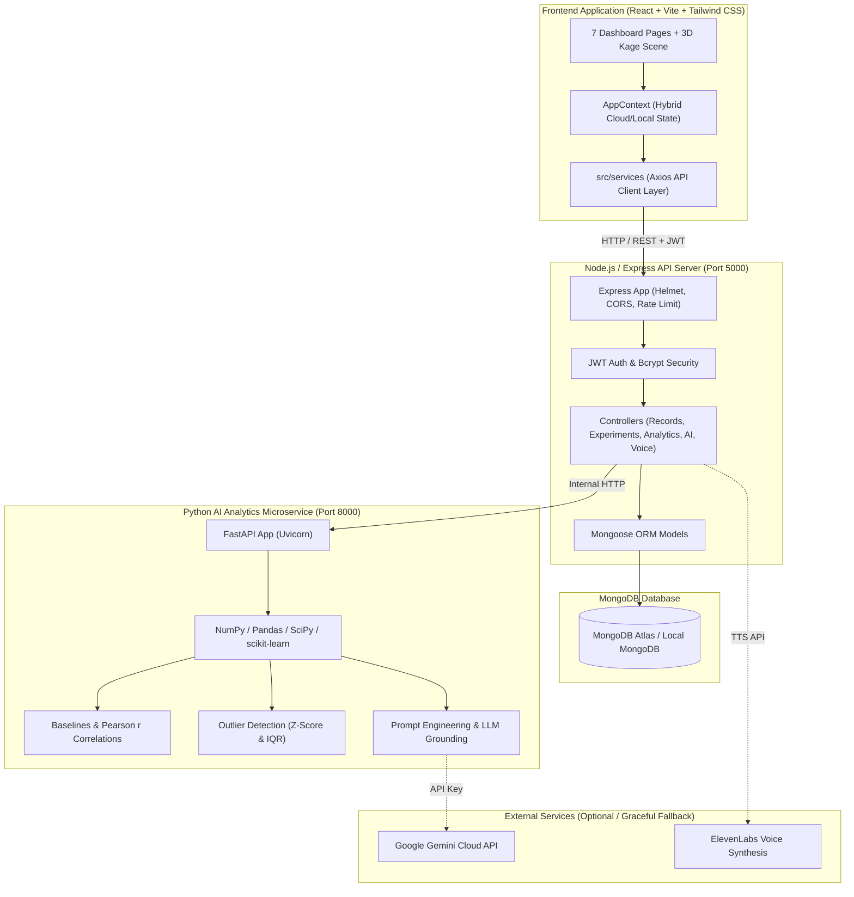

# DayLens — Personal Intelligence Platform
> **Hackathon:** wHACKiest 2026 | **Track:** Track 3 – *Know Thyself*  
> **Tagline:** *Your life, understood through your data.*

DayLens is an AI-powered personal intelligence platform that unites daily biometric, behavioural, and emotional metrics—sleep, physical activity, screen time, mood, and cognitive focus. It uncovers personal patterns, grounds them in rigorous statistical analysis, and empowers users to conduct measurable habit experiments.

---

## 🏛️ System Architecture



---

## 🚀 Quick Start Guide

### 1. Prerequisites
- **Node.js** >= 18.x
- **Python** >= 3.10
- **MongoDB** (Local `mongodb://127.0.0.1:27017` or MongoDB Atlas URI)

### 2. Python AI Service Setup
```powershell
cd ai-service
pip install -r requirements.txt
python -m uvicorn main:app --host 127.0.0.1 --port 8000
```
*Health Check:* `http://localhost:8000/health`

### 3. Node.js Backend Setup
```powershell
cd backend
npm install
# Configure backend/.env (defaults to local MongoDB and port 5000)
node src/server.js
```
*Health Check:* `http://localhost:5000/api/health`

### 4. React Frontend Setup
```powershell
npm install
npm run dev
```
*Frontend URL:* `http://localhost:5173`

---

## 📡 Backend API Reference

### Authentication (`/api/auth`)
| Method | Endpoint | Description |
|---|---|---|
| `POST` | `/api/auth/register` | Register new user account with hashed password |
| `POST` | `/api/auth/login` | Authenticate user and issue JWT token |
| `POST` | `/api/auth/demo-login` | 1-Click instant login as Alex Morgan with seeded demo data |
| `GET` | `/api/auth/me` | Retrieve authenticated user profile and privacy consent |
| `POST` | `/api/auth/logout` | End session |

### Daily Records (`/api/records`)
| Method | Endpoint | Description |
|---|---|---|
| `GET` | `/api/records` | Query daily records (filters: `range=7d\|30d\|all`, `startDate`, `endDate`) |
| `POST` | `/api/records` | Create or update daily record (upserts by user + date) |
| `GET` | `/api/records/:id` | Get individual record by ID |
| `PUT` | `/api/records/:id` | Update daily record fields |
| `DELETE`| `/api/records/:id` | Remove daily record |
| `POST` | `/api/records/import-csv`| Batch parse and upsert CSV records |
| `GET` | `/api/records/export` | Export records as JSON or CSV file |

### Experiment Lab (`/api/experiments`)
| Method | Endpoint | Description |
|---|---|---|
| `GET` | `/api/experiments` | List user's active, paused, and completed experiments |
| `POST` | `/api/experiments` | Create new habit experiment |
| `PATCH`| `/api/experiments/:id/toggle-day` | Check in or uncheck completed day |
| `PATCH`| `/api/experiments/:id/status` | Update status (`active`, `paused`, `completed`) |
| `GET` | `/api/experiments/:id/comparison` | Pre-experiment baseline vs active intervention delta |

### Statistical Analytics & Insights (`/api/analytics`)
| Method | Endpoint | Description |
|---|---|---|
| `GET` | `/api/analytics/overview` | Mean, standard deviation, and 7-day moving averages |
| `GET` | `/api/analytics/correlations`| Full Pearson $r$ correlation matrix & pattern summaries |
| `GET` | `/api/analytics/trends` | 7-day and 30-day smoothed metric trajectories |
| `GET` | `/api/analytics/anomalies`| Z-score and IQR statistical outlier detection ($|z| \ge 2.0$) |
| `GET` | `/api/analytics/insights` | Actionable pattern cards and recommended habit adjustments |

### DayLens AI Assistant & Voice (`/api/assistant`, `/api/voice`)
| Method | Endpoint | Description |
|---|---|---|
| `POST` | `/api/assistant/chat` | Send user inquiry; routes through Python AI service |
| `GET` | `/api/assistant/history` | Retrieve conversation history |
| `DELETE`| `/api/assistant/history` | Clear conversational memory |
| `POST` | `/api/voice/speak` | Stream ElevenLabs TTS audio (or indicate browser fallback) |
| `GET` | `/api/voice/status` | Check ElevenLabs API status |

### Privacy & Data Sovereignty (`/api/privacy`)
| Method | Endpoint | Description |
|---|---|---|
| `GET` | `/api/privacy/consent` | Fetch user data sovereignty and consent flags |
| `PUT` | `/api/privacy/consent` | Update consent preferences |
| `POST` | `/api/privacy/export-all`| Full JSON takeout of records, experiments, chats, and consent |
| `DELETE`| `/api/privacy/delete-all`| Complete GDPR Article 17 account and data erasure |

---

## 🧪 Automated End-to-End Testing

Run the included verification suite against the running backend and AI microservice:
```powershell
node backend/test_e2e.cjs
```
All 12 automated checks test authentication, record ingestion, experiment progress, correlation calculations, Python FastAPI integration, ElevenLabs fallback, and GDPR deletion.
